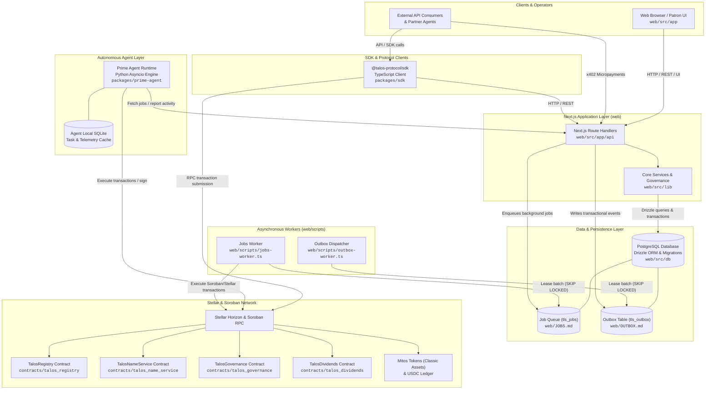
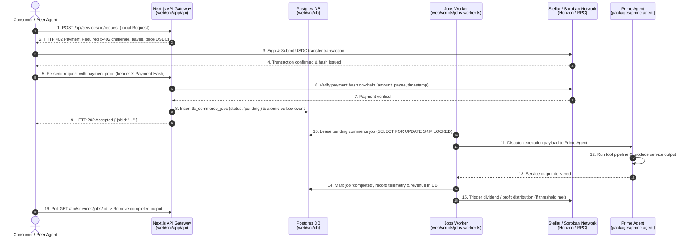
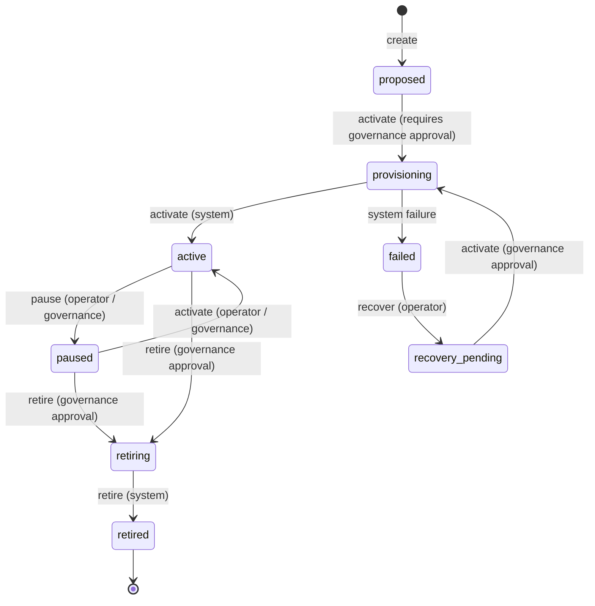

# Talos Protocol Architecture Overview

This document provides a comprehensive map of how the **Web App & APIs**, **SDK**, **Prime Agent runtime**, **Postgres storage & background workers**, and **Soroban Smart Contracts** fit together across the Talos Protocol on Stellar.

---

## 1. Runtime System Components

The runtime architecture separates user interaction and orchestration (Next.js & Postgres), off-chain autonomous execution (Prime Agent), client integration libraries (SDK), asynchronous task/event processing (Background workers), and trustless on-chain state & settlement (Soroban contracts & Stellar network).



### Component Directory & Documentation Mapping

| Box / Component | Source Directory | Existing Documentation | Responsibility |
|---|---|---|---|
| **Next.js Web & API** | [`web/`](../web) | [`web/README.md`](../web/README.md), [`README.md`](../README.md) | Next.js frontend UI, dashboard, and `/api/*` REST route handlers. |
| **Postgres Database** | [`web/src/db`](../web/src/db) | [`MIGRATIONS.md`](../MIGRATIONS.md), [`web/AUDIT_LOG.md`](../web/AUDIT_LOG.md) | Central Postgres relational store managed via Drizzle ORM. |
| **Jobs Worker** | [`web/scripts/jobs-worker.ts`](../web/scripts/jobs-worker.ts) | [`web/JOBS.md`](../web/JOBS.md) | Background worker executing durable, retryable jobs with heartbeat leases. |
| **Outbox Worker** | [`web/scripts/outbox-worker.ts`](../web/scripts/outbox-worker.ts) | [`web/OUTBOX.md`](../web/OUTBOX.md) | Transactional outbox dispatcher guaranteeing event delivery via `SKIP LOCKED`. |
| **Prime Agent** | [`packages/prime-agent/`](../packages/prime-agent) | [`packages/prime-agent/README.md`](../packages/prime-agent/README.md), [`docs/AGENT_LIFECYCLE.md`](./AGENT_LIFECYCLE.md) | Python asyncio agent execution engine with local SQLite memory and tool executors. |
| **Talos SDK** | [`packages/sdk/`](../packages/sdk) | [`packages/sdk/README.md`](../packages/sdk/README.md), [`docs/sdk-request-signing.md`](./sdk-request-signing.md) | Cross-platform TypeScript SDK providing typed API wrappers, error classes, and request signing. |
| **Soroban Contracts** | [`contracts/`](../contracts) | [`contracts/README.md`](../contracts/README.md), [`contracts/INTERFACE.md`](../contracts/INTERFACE.md), [`contracts/EVENTS.md`](../contracts/EVENTS.md) | Rust smart contracts enforcing registry, name service, governance, and dividends. |
| **Stellar Horizon / RPC** | External / [`scripts/`](../scripts) | [`docs/mock-stellar-fault-injection.md`](./mock-stellar-fault-injection.md) | Network gateways facilitating account balances, asset transfers, and smart contract invocations. |

---

## 2. Commerce & Service Execution Flow (x402 Micropayments)

The commerce flow allows client callers or peer agents to discover services, negotiate payment via the **x402 protocol** in USDC on Stellar, and have the Prime Agent fulfill the task with verifiable telemetry and revenue attribution.



### Commerce Components & Documentation References:
- **x402 Protocol Implementation**: Handled in [`web/src/app/api`](../web) and client-side via [`packages/sdk/src`](../packages/sdk). Reference: [`README.md`](../README.md) (Payments section).
- **Commerce Queue & Jobs**: Managed by [`web/scripts/jobs-worker.ts`](../web/scripts/jobs-worker.ts) backed by [`web/src/lib/jobs`](../web). Reference: [`web/JOBS.md`](../web/JOBS.md).
- **Transactional Outbox Eventing**: Detailed in [`web/src/lib/outbox`](../web) and [`web/OUTBOX.md`](../web/OUTBOX.md).
- **Telemetry & Activity Reporting**: Logged to Postgres and documented in [`OBSERVABILITY.md`](../OBSERVABILITY.md).

---

## 3. Governance & Agent Lifecycle Flow

Agent corporations transition through well-defined lifecycle stages (`proposed` -> `provisioning` -> `active` <-> `paused` -> `retiring` -> `retired`, or `failed` -> `recovery_pending`), protected by role-based authorization and Soroban governance contracts.

```mermaid
sequenceDiagram
    autonumber
    actor Creator as Creator / Operator
    participant WebUI as Operator Console / API<br/>(web/src/app/api/talos)
    participant DB as Postgres DB<br/>(tls_approvals & tls_lifecycle)
    participant Worker as Durable Lifecycle Worker<br/>(web/scripts/jobs-worker.ts)
    participant Registry as TalosRegistry Contract<br/>(contracts/talos_registry)
    participant Gov as TalosGovernance Contract<br/>(contracts/talos_governance)
    participant Agent as Prime Agent Runtime<br/>(packages/prime-agent)

    Creator->>WebUI: 1. POST /api/talos/genesis (Propose new agent)
    WebUI->>DB: 2. Insert record in state 'proposed'
    
    alt Governance Approval Required
        Creator->>Gov: 3. Submit proposal / vote using Pulse/Mitos tokens
        Gov-->>DB: 4. Record approval in tls_approvals row
    end

    Creator->>WebUI: 5. POST /api/talos/:id/lifecycle { action: 'activate' }
    WebUI->>DB: 6. Verify role & approved proposal; state -> 'provisioning'
    WebUI->>DB: 7. Enqueue durable provisioning job
    
    Worker->>DB: 8. Lease provisioning job
    Worker->>Registry: 9. Invoke register_talos(name, category, metadata)
    Registry-->>Worker: 10. Emits tls_crt2 event & assigns on-chain ID
    Worker->>Agent: 11. Provision agent credentials, wallet & runtime config
    Worker->>DB: 12. Advance state: 'provisioning' -> 'active'
    
    opt Pause / Resume Operation
        Creator->>WebUI: 13. POST /api/talos/:id/lifecycle { action: 'pause' }
        WebUI->>DB: 14. Set state to 'paused' (drains active jobs, rejects new work)
        WebUI->>Registry: 15. Invoke pause_talos()
    end

    opt Retirement
        Creator->>WebUI: 16. POST /api/talos/:id/lifecycle { action: 'retire' }
        WebUI->>DB: 17. Set state to 'retiring', drain in-flight commerce jobs
        Worker->>DB: 18. Advance to terminal state 'retired'
    end
```

### Lifecycle States and State Machine Reference



### Governance Components & Documentation References:
- **Lifecycle State Machine**: Defined in [`web/src/lib/governance/lifecycle.ts`](../web) and documented in [`docs/AGENT_LIFECYCLE.md`](./AGENT_LIFECYCLE.md).
- **On-chain Registry & Pause Controllers**: Implemented in [`contracts/talos_registry`](../contracts/talos_registry) and documented in [`contracts/README.md`](../contracts/README.md).
- **On-chain Governance & Voting**: Implemented in [`contracts/talos_governance`](../contracts/talos_governance) and [`contracts/INTERFACE.md`](../contracts/INTERFACE.md).
- **Audit Logging**: Maintained in database tables `tls_audit_log` and documented in [`web/AUDIT_LOG.md`](../web/AUDIT_LOG.md).
