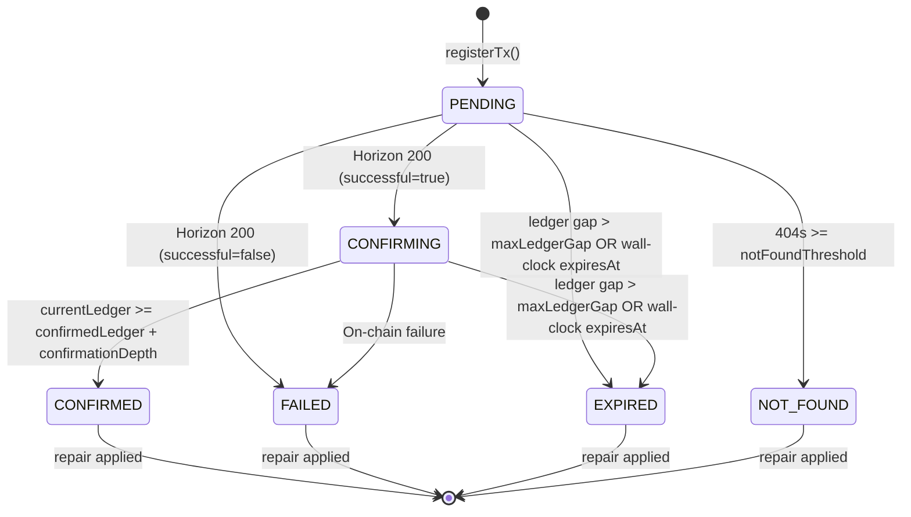

# Stellar Payment Reconciler

A background reconciler and finality state machine that verifies submitted Stellar payment transactions against Horizon, detects finality (settlement, on-chain failure, ledger gap expiry, or missing transactions), applies idempotent downstream repairs to commerce jobs and token purchases, and provides operator inspection and intervention endpoints.

---

## Status Lifecycle & State Machine

Transactions are tracked through the finality state machine defined in `src/lib/reconciler/state-machine.ts` and `src/lib/reconciler/types.ts`.

### State Diagram



Text lifecycle overview:

```
PENDING ──(Horizon 200, success)──→ CONFIRMING ──(depth reached)──→ CONFIRMED (terminal)
   │                                     │
   ├──(Horizon 200, failed)──────────────┴──(failure reported)────→ FAILED    (terminal)
   │
   ├──(ledger gap / wall-clock)──────────┴──(gap / wall-clock)────→ EXPIRED   (terminal)
   │
   └──(404s >= notFoundThreshold)─────────────────────────────────→ NOT_FOUND (terminal)
```

### State Definitions

| State | Classification | Description |
|---|---|---|
| `PENDING` | Active | Initial state. Transaction submitted to Stellar, not yet found on Horizon. Eligible for polling until found, expired by ledger gap, or expired by wall-clock time. |
| `CONFIRMING` | Active | Transaction detected in a closed ledger with `successful: true`. Awaiting the required confirmation depth (`confirmationDepth`) to guarantee finality. |
| `CONFIRMED` | Terminal | Transaction permanently settled on-chain (`currentLedger >= confirmedLedger + confirmationDepth`). Downstream repair is applied. |
| `FAILED` | Terminal | Transaction was included in a closed ledger but operation execution failed on-chain (e.g. sequence number mismatch, insufficient balance, bad authorization). Downstream repair marks the originating entity as failed. |
| `EXPIRED` | Terminal | Transaction never settled within the ledger gap window (`currentLedger > ledgerSubmitted + maxLedgerGap`) or exceeded its wall-clock `expiresAt`. Downstream repair marks the originating entity as expired. |
| `NOT_FOUND` | Terminal | Horizon returned 404 repeatedly for `notFoundThreshold` consecutive poll ticks. Downstream repair marks the originating entity as failed/not found. |

- **`ACTIVE_STATES`** (`PENDING`, `CONFIRMING`): Polled and evaluated by the background scheduler tick.
- **`TERMINAL_STATES`** (`CONFIRMED`, `FAILED`, `EXPIRED`, `NOT_FOUND`): Immutable final states. No further polling occurs. Terminal states trigger downstream repair if `repairApplied` is `false`.

### Transition Rules

Transitions are purely functional and validated (`validateTransition`) before any database write:

1. **`PENDING` → `CONFIRMING`**: Horizon returns HTTP 200 with `successful: true`. Sets `confirmedLedger` to the transaction's ledger sequence.
2. **`PENDING` → `FAILED`**: Horizon returns HTTP 200 with `successful: false`. Sets `confirmedLedger` and extracts diagnostic `lastError` (e.g., transaction-level result code from envelope extras).
3. **`PENDING` → `NOT_FOUND`**: Horizon returns HTTP 404 and `pollCount + 1 >= notFoundThreshold`.
4. **`PENDING` → `EXPIRED`**: Triggered when either:
   - Current ledger exceeds `ledgerSubmitted + maxLedgerGap` (`isLedgerExpired`), or
   - Current wall-clock time exceeds `expiresAt` (`isWallClockExpired`).
5. **`CONFIRMING` → `CONFIRMED`**: `currentLedger >= confirmedLedger + confirmationDepth`. Stellar has single-round finality upon ledger close; `confirmationDepth` defaults to 1.
6. **`CONFIRMING` → `FAILED`**: Defensively permitted if chain data indicates operation-level failure.
7. **`CONFIRMING` → `EXPIRED`**: Exceeds ledger gap or wall-clock `expiresAt` while confirming.
8. **Transient Horizon Errors**: Network errors, HTTP 429 (rate limit), and HTTP 5xx responses increment `pollCount` and set `lastError`, but leave the record in `PENDING` for the next tick.
9. **Terminal Immutability**: Any attempt to transition out of a terminal state is rejected with an illegal transition error (`Illegal transition: cannot leave terminal state "<state>"`).

---

## Configuration

All configuration is loaded from environment variables at startup in `src/lib/reconciler/config.ts`. All variables are optional with safe defaults:

| Variable | Default | Meaning |
|---|---|---|
| `RECONCILER_ENABLED` | `false` | Master switch. Activates the background scheduler loop when set to `"true"`. |
| `RECONCILER_POLL_INTERVAL_MS` | `30000` | Scheduling interval in milliseconds between background loop ticks. |
| `RECONCILER_MAX_LEDGER_GAP` | `120` | Maximum ledger sequence difference before an active transaction is marked `EXPIRED` (~10 minutes at ~5 seconds per Stellar ledger). |
| `RECONCILER_NOT_FOUND_THRESHOLD` | `10` | Number of consecutive 404 poll results from Horizon before transitioning a `PENDING` record to `NOT_FOUND`. |
| `RECONCILER_BATCH_SIZE` | `50` | Maximum number of active records (`PENDING` or `CONFIRMING`) processed per tick. |
| `STELLAR_HORIZON_URL` | `https://horizon-testnet.stellar.org` | Base URL of the Stellar Horizon server used to query transaction status and current ledger. |
| `RECONCILER_CONFIRMATION_DEPTH` | `1` | Number of closed ledgers required after first-seen before transitioning from `CONFIRMING` to `CONFIRMED`. |
| `RECONCILER_CONCURRENCY_LIMIT` | `5` | Maximum number of concurrent Horizon/DB operations allowed during tick queue draining. |
| `ADMIN_API_KEY` | — | Bearer token required for administrative endpoints (`/api/admin/reconciler/*`). |

---

## Scheduling & Execution Lifecycle

The scheduler (`src/lib/reconciler/scheduler.ts`) orchestrates the background loop:

### Process-Level Singleton

- The scheduler timer, queue state, and in-memory statistics are stored on `globalThis`.
- This ensures only one background loop runs per Node.js process, preventing duplicate loops during Next.js hot-reloads in development or across server-component imports.

### Startup & Shutdown

- **Startup**: `src/instrumentation.ts` calls `startReconciler()` at server boot. If `RECONCILER_ENABLED !== "true"`, the function immediately logs `reconciler_disabled` and exits.
- When enabled, `startReconciler()` initializes runtime stats, fires an immediate tick, and schedules recurring ticks via `setInterval`.
- **Graceful Shutdown**: `stopReconciler()` clears the interval timer, signals cancellation via `AbortController`, empties in-flight queues, and resolves pending callbacks.

### Tick Flow

Each execution of `runOneTick()`:

1. **Horizon Ledger Fetch**: Calls `fetchCurrentLedger(horizonUrl)`. If Horizon is unreachable (`null`), records an error, logs a warning (`reconciler_tick_no_ledger`), and terminates the tick.
2. **Batch Query**: Loads up to `batchSize` records where `finalityStatus IN ('PENDING', 'CONFIRMING')`, ordered by `updatedAt ASC`.
3. **Concurrency-Limited Queue**: Pushes new records into a queue drained up to `concurrencyLimit` concurrent workers.
4. **Record Evaluation**:
   - For `PENDING`: queries Horizon via `pollTransaction(txHash, horizonUrl)`.
   - For `CONFIRMING`: checks ledger depth against `currentLedger`.
   - Evaluates pure state transition via `computeTransition()`.
   - Validates transition with `validateTransition()`.
   - Persists state changes atomically to `tls_stellar_tx_records`.
   - If the record entered a terminal state and `repairApplied === false`, invokes `applyRepair()`.
5. **Observability Snapshot**: Updates in-process `ReconcilerStats` counters and logs tick metrics.

---

## Downstream Repair Actions

When a tracked transaction reaches a terminal state, `applyRepair()` in `src/lib/reconciler/repair.ts` propagates the outcome to the originating domain entity.

### Repair Guarantees

- **Idempotent**: Executing a repair multiple times leaves the database in the exact same state as executing it once.
- **Conditional**: Only modifies domain rows still in an initial/waiting state (`pending`), preventing double-application or overwriting subsequent states.
- **Atomic**: Wrapped in a database update with returning clause; partial failures leave rows unchanged.
- **Privacy-Safe**: No secrets, user payloads, or private keys are processed or logged.

### Subsystem Handlers

#### 1. Commerce Jobs (`sourceType: "commerce_job"`)

`sourceId` corresponds to `tls_commerce_jobs.id`.

| Finality State | Downstream Action |
|---|---|
| `CONFIRMED` | Payment is settled on-chain. Job remains in `"pending"` for agent fulfillment (or unchanged if already completed). |
| `FAILED` | Job transitions from `"pending"` to `"payment_failed"`. |
| `EXPIRED` | Job transitions from `"pending"` to `"payment_expired"`. |
| `NOT_FOUND` | Job transitions from `"pending"` to `"payment_not_found"`. |

If the job is no longer `"pending"`, repair is a no-op (`repaired: false`). Once handled, `repairApplied` is set to `true` on the `tls_stellar_tx_records` row.

#### 2. Token Purchases (`sourceType: "token_purchase"`)

`sourceId` corresponds to `txHash` in `tls_token_purchases`.

| Finality State | Downstream Action |
|---|---|
| `CONFIRMED` | Normal path: purchase is already marked `"completed"` by the buy-token route. If still `"pending"`, logs `reconciler_token_purchase_stuck_pending_after_confirm` for manual operator review. |
| `FAILED` | Purchase transitions from `"pending"` to `"failed"`. |
| `EXPIRED` | Purchase transitions from `"pending"` to `"failed"`. |
| `NOT_FOUND` | Purchase transitions from `"pending"` to `"failed"`. |

#### 3. Other (`sourceType: "other"`)

Marked as handled (`repaired: false, repairApplied: true`) with no downstream database mutation required.

---

## Registration

Subsystems register transactions for tracking using `registerTx()`:

```ts
import { registerTx } from "@/lib/reconciler";

await registerTx({
  txHash: "68b49e...",
  sourceType: "commerce_job", // or "token_purchase", "other"
  sourceId: job.id,
  ledgerSubmitted: 123456,   // optional, enables ledger gap expiry
  expiresAt: new Date(Date.now() + 2 * 60 * 60 * 1000), // optional wall-clock TTL
});
```

- **Idempotent**: Re-registering an existing `txHash` returns the existing record ID without duplicating rows or throwing.
- **Fire-and-Forget Safe**: In routes such as `buy-token` and `jobs`, `registerTx` is called after the main database transaction commits, ensuring route responses are not blocked or failed if registration encounters an issue.

---

## Admin Endpoints & Operator Intervention

Administrative routes require bearer token authorization:
`Authorization: Bearer <ADMIN_API_KEY>`

### 1. Reconciler Status Snapshot

Inspect the live runtime status, counters, and queue state:

```http
GET /api/admin/reconciler
Authorization: Bearer <ADMIN_API_KEY>
```

#### Example Request

```bash
curl -X GET http://localhost:3000/api/admin/reconciler \
  -H "Authorization: Bearer dev-admin-key"
```

#### Example Response (200 OK)

```json
{
  "stats": {
    "startedAt": "2026-10-17T05:00:00.000Z",
    "lastTickAt": "2026-10-17T05:10:00.000Z",
    "lastTickDurationMs": 142,
    "tickCount": 20,
    "totalConfirmed": 12,
    "totalFailed": 1,
    "totalExpired": 0,
    "totalNotFound": 0,
    "totalRepairsApplied": 13,
    "totalErrors": 0,
    "activeCount": 0,
    "queueCount": 0
  }
}
```

#### Status Codes
- `200 OK`: Stats returned.
- `401 Unauthorized`: Missing `Authorization` header.
- `403 Forbidden`: Invalid bearer token.
- `500 Internal Server Error`: `ADMIN_API_KEY` not configured on the server.

---

### 2. Force Reconciliation Tick

Trigger a single reconciliation tick synchronously without waiting for the scheduled interval. Used by operators to immediately process pending payments or in automated tests.

```http
POST /api/admin/reconciler/force
Authorization: Bearer <ADMIN_API_KEY>
```

#### Example Request

```bash
curl -X POST http://localhost:3000/api/admin/reconciler/force \
  -H "Authorization: Bearer dev-admin-key"
```

#### Example Response (200 OK)

```json
{
  "summary": {
    "processed": 5,
    "confirmed": 3,
    "failed": 0,
    "expired": 0,
    "notFound": 1,
    "repairsApplied": 4,
    "errors": 0,
    "currentLedger": 1234567
  }
}
```

#### Example Response: Horizon Unreachable (503 Service Unavailable)

If Horizon cannot be contacted, the tick returns HTTP 503 along with the partial summary so operators can differentiate upstream network issues from an empty queue:

```json
{
  "error": "Horizon unreachable — tick ran with no ledger data",
  "summary": {
    "processed": 0,
    "confirmed": 0,
    "failed": 0,
    "expired": 0,
    "notFound": 0,
    "repairsApplied": 0,
    "errors": 1,
    "currentLedger": null
  }
}
```

#### Status Codes
- `200 OK`: Synchronous tick completed successfully.
- `503 Service Unavailable`: Horizon unreachable (`currentLedger === null`).
- `401 Unauthorized`: Missing `Authorization` header.
- `403 Forbidden`: Invalid bearer token.
- `500 Internal Server Error`: Server error or unconfigured `ADMIN_API_KEY`.

---

### 3. Public Payment Status Endpoint

Contributors and clients can inspect payment finality for a specific commerce job without an admin API key:

```http
GET /api/talos/:id/jobs/:jobId/payment-status
```

#### Example Request

```bash
curl -X GET http://localhost:3000/api/talos/talos_123/jobs/job_456/payment-status
```

#### Example Response (200 OK — Tracked Job)

```json
{
  "jobId": "job_456",
  "txHash": "68b49e7978648174780650123512341234123412341234123412341234123412",
  "finalityStatus": "CONFIRMED",
  "confirmedLedger": 1234567,
  "lastLedgerChecked": 1234568,
  "pollCount": 2,
  "lastError": null,
  "repairApplied": true,
  "updatedAt": "2026-10-17T05:10:00.000Z"
}
```

#### Example Response (200 OK — Unregistered / Instant Job)

```json
{
  "jobId": "job_456",
  "txHash": "68b49e...",
  "finalityStatus": null,
  "registered": false
}
```

#### Status Codes
- `200 OK`: Job found, finality status or unregistered payload returned.
- `404 Not Found`: Job does not exist or does not belong to the specified `talosId`.
- `500 Internal Server Error`: Generic internal server error.

---

## Database Schema

Tracked transaction records are persisted in `tls_stellar_tx_records`:

| Column | Type | Description |
|---|---|---|
| `id` | `text` (Primary Key) | CUID2 record identifier. |
| `tx_hash` | `text` (Unique) | 64-character hex Stellar transaction hash. |
| `source_type` | `text` | Subsystem type (`"commerce_job"`, `"token_purchase"`, `"other"`). |
| `source_id` | `text` | Target entity identifier (`jobId` or purchase `txHash`). |
| `finality_status` | `text` | Current state (`PENDING`, `CONFIRMING`, `CONFIRMED`, `FAILED`, `EXPIRED`, `NOT_FOUND`). |
| `ledger_submitted` | `integer` | Ledger sequence when submitted (if known). |
| `last_ledger_checked`| `integer` | Most recent ledger polled. |
| `confirmed_ledger` | `integer` | Ledger in which transaction was permanently included. |
| `poll_count` | `integer` | Number of poll attempts. |
| `last_error` | `text` | Privacy-safe diagnostic error code or message. |
| `repair_applied` | `boolean` | `true` once downstream repair has completed. |
| `expires_at` | `timestamp` | Wall-clock expiry timestamp. |
| `created_at` | `timestamp` | Row creation timestamp. |
| `updated_at` | `timestamp` | Row last update timestamp. |

Indexes:
- `tls_stellar_tx_records_tx_hash_unique`: Unique index on `tx_hash`.
- `tls_stellar_tx_records_status_updated_idx`: Composite index on `(finality_status, updated_at)`.
- `tls_stellar_tx_records_source_idx`: Composite index on `(source_type, source_id)`.

---

## Observability & Privacy Contract

- **Structured Pino Logging**: Every poll, transition, tick, and repair produces structured JSON logs (`reconciler_started`, `reconciler_stopped`, `reconciler_tick_start`, `reconciler_tick_complete`, `reconciler_poll_result`, `reconciler_state_transition`, `reconciler_repair_applied`, `reconciler_repair_noop`, `reconciler_repair_failed`).
- **Privacy Guarantees**:
  - No secret keys (`S...`), private keys, or seed phrases are ever logged or returned in responses.
  - `lastError` contains only safe transaction result codes (e.g. `tx_bad_seq`, `tx_failed`) or truncated reconciler diagnostic messages.
  - Admin responses return statistical counters and summary objects, omitting customer payloads and secret tokens.

---

## Local Verification

Run the reconciler unit and route test suites:

```bash
cd web
pnpm vitest run tests/reconciler-state-machine.unit.test.ts
pnpm vitest run tests/reconciler-scheduler.unit.test.ts
pnpm vitest run tests/reconciler-api-routes.unit.test.ts
pnpm vitest run tests/reconciler-route-wiring.unit.test.ts
```

Test the admin endpoints locally:

```bash
export RECONCILER_ENABLED=true
export ADMIN_API_KEY=dev-admin-key
pnpm dev

# Check reconciler status
curl -H "Authorization: Bearer dev-admin-key" http://localhost:3000/api/admin/reconciler

# Force a synchronous reconciliation tick
curl -X POST -H "Authorization: Bearer dev-admin-key" http://localhost:3000/api/admin/reconciler/force
```
